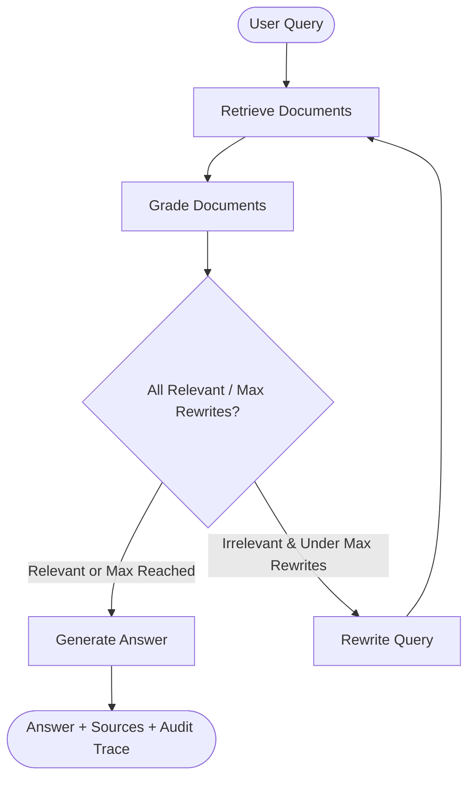

# Athena RAG — Production-Grade Agentic Retrieval System

> **Project Codename:** `athena-rag`  
> **Target Signal:** Proves you can architect, evaluate, and deploy a self-correcting retrieval-augmented generation (RAG) system with active document grading, query rewriting, and strict context grounding.

---

## 1. Executive Summary

Standard RAG pipelines retrieve context once and unconditionally feed it to a generative language model. In real-world enterprise environments, this single-step approach suffers from two severe failure modes:
1. **Irrelevant Context Pollution:** Retaining irrelevant chunks encourages the language model to hallucinate or weave incorrect assumptions into answers.
2. **Ambiguous or Poorly Phrased Queries:** When users submit vague questions, vector similarity returns poor candidate documents, and typical pipelines fail silently.

**Athena RAG** replaces naive retrieval with an agentic, self-correcting state graph built with **LangGraph**, **FastAPI**, **ChromaDB**, and **OpenAI**:
* **Binary Document Grading:** Every retrieved chunk is independently evaluated for semantic relevance before entering the prompt context.
* **Self-Correction Query Rewriting:** If candidate documents fail grading, the query is reformulated and retrieved again (up to a configurable attempt threshold).
* **Context Grounding & Source Attribution:** Answers are generated strictly from verified context and cite exact source documents.
* **Structured Observability:** Every retrieval step, relevance score, query rewrite, and generation action is captured in structured JSON logs and an audit trace.

---

## 2. Architecture Overview

### LangGraph State Machine



### System Architecture

```text
┌────────────────────────────────────────────────────────────────┐
│                         FASTAPI LAYER                          │
│  POST /query  ──► State Graph ──► Grounded Answer + Citations  │
│  POST /ingest ──► Document Ingestion Pipeline                  │
│  GET  /health ──► Readiness Probe                              │
└────────────────────────────────────────────────────────────────┘
                              │
                              ▼
┌────────────────────────────────────────────────────────────────┐
│                    LANGGRAPH RAG WORKFLOW                      │
│                                                                │
│  [retrieve] ──► [grade_documents] ──► ┌─[generate_answer]──┐   │
│       ▲                               └─[rewrite_question]──┘   │
│       │                                        │               │
│       └────────────────────────────────────────┘               │
│                    (Self-Correction Loop)                      │
└────────────────────────────────────────────────────────────────┘
                              │
                              ▼
┌────────────────────────────────────────────────────────────────┐
│                      VECTOR STORE LAYER                        │
│  ChromaDB (Local / Dev) ──► Swappable with Qdrant / Milvus     │
│  OpenAI Embeddings (text-embedding-3-small)                    │
└────────────────────────────────────────────────────────────────┘
```

---

## 3. Repository Structure

```text
athena-rag/
├── README.md               # Architecture documentation & operational runbook
├── pyproject.toml          # Packaging metadata and pytest configuration
├── requirements.txt        # Pinned dependencies
├── .env.example            # Environment variable template
├── .env                    # Local runtime environment file
├── .gitignore              # Git ignore rules for virtual environments and databases
├── Dockerfile              # Container definition for containerized deployment
├── render.yaml             # Render blueprint configuration
├── src/
│   └── athena/
│       ├── __init__.py     # Package initialization and version definition
│       ├── main.py         # Local CLI testing harness
│       ├── api.py          # FastAPI application routes (/query, /ingest, /health)
│       ├── graph.py        # LangGraph StateGraph assembly and routing
│       ├── state.py        # TypedDict RAGState definition
│       ├── observability.py# Structured JSON logging utility
│       ├── ingestion.py    # Document loading, validation, chunking, and ingestion
│       ├── nodes/
│       │   ├── __init__.py # Node exports
│       │   ├── retrieve.py # Document retrieval node
│       │   ├── grade.py    # LLM-based binary relevance grading node
│       │   ├── rewrite.py  # Search query reformulation node
│       │   └── generate.py # Grounded answer generation node
│       └── tools/
│           ├── __init__.py # Tool exports
│           └── vectorstore.py # Chroma vector store and retriever abstraction
├── tests/
│   ├── __init__.py
│   ├── test_grade.py       # Unit tests for document grading
│   ├── test_rewrite.py     # Unit tests for query rewriting
│   ├── test_e2e.py         # End-to-end graph tests (happy path + self-correction)
│   ├── test_api.py         # FastAPI endpoint tests
│   └── test_ingestion.py   # Ingestion and chunking unit tests
└── data/
    └── sample_docs.json    # Initial reference knowledge base documents
```

---

## 4. Quickstart Guide

### Prerequisites
* Python 3.11 or higher
* Valid OpenAI API key (`OPENAI_API_KEY`)

### Step 1: Environment Setup

Clone or navigate to the repository directory:
```bash
cd athena-rag
```

Create and activate a virtual environment:
```bash
# Using standard Python
python -m venv .venv
source .venv/bin/activate    # On Linux/macOS
# or on Windows PowerShell:
.\.venv\Scripts\Activate.ps1

# Alternatively using uv (ultra-fast):
uv venv --python 3.11
.\.venv\Scripts\Activate.ps1
```

### Step 2: Install Dependencies

```bash
pip install -r requirements.txt
pip install -e .
```

### Step 3: Configure Environment Variables

Copy `.env.example` to `.env` and set your OpenAI API key:
```bash
cp .env.example .env
```
Inside `.env`:
```env
OPENAI_API_KEY=sk-your-openai-api-key-here
LOG_LEVEL=INFO
```

### Step 4: Ingest Sample Knowledge Base

Populate the local ChromaDB vector store with the provided reference documents:
```bash
python -c "from athena.ingestion import load_documents_from_json, ingest_documents; docs = load_documents_from_json('data/sample_docs.json'); ingest_documents(docs)"
```

### Step 5: Run the Streamlit Interactive Web UI (PDF Upload + Q&A)

To launch the full interactive web application where users can drag-and-drop 100+ page PDFs, submit, and chat:
```bash
streamlit run src/athena/ui.py
```
This opens the web interface in your browser at `http://localhost:8501`.
* **Sidebar**: Drag-and-drop or select any PDF file (supports 100+ pages), adjust chunk sizes, and click **"🚀 Ingest & Index Document"** with real-time progress.
* **Chat Area**: Ask questions directly. Answers display grounded explanations, exact source citations with page numbers (e.g. `report.pdf (Page 42)`), and an expandable **LangGraph Self-Correction Trace**.

### Step 6: Run the CLI Test Harness

Execute a sample question directly from the command line:
```bash
python -m athena.main "What is agentic RAG?"
```

Sample output:
```text
============================================================
Question: What is agentic RAG?
------------------------------------------------------------
Answer: Agentic RAG extends standard RAG by allowing the agent to decide when and how to retrieve. It incorporates quality grading, query rewriting, and self-correction loops to enhance accuracy on ambiguous queries.
Sources: ['agentic_rag.md']
Rewrites: 0
------------------------------------------------------------
Trace:
  {'node': 'retrieve', 'query': 'What is agentic RAG?', 'count': 3}
  {'node': 'grade', 'scores': ['yes'], 'all_relevant': True}
  {'node': 'generate', 'sources': ['agentic_rag.md']}
```

---

## 5. Running the REST API

Launch the production FastAPI service using Uvicorn:
```bash
uvicorn athena.api:app --reload --host 0.0.0.0 --port 8000
```

Interactive OpenAPI Swagger documentation will be available at:
`http://localhost:8000/docs`

### API Endpoints

#### 1. Readiness Probe (`GET /health`)
```bash
curl http://localhost:8000/health
```
Response:
```json
{
  "status": "ok"
}
```

#### 2. Query Pipeline (`POST /query`)
```bash
curl -X POST "http://localhost:8000/query" \
  -H "Content-Type: application/json" \
  -d '{
    "question": "How does agentic RAG compare to standard 2-step RAG?",
    "max_rewrites": 2
  }'
```
Response:
```json
{
  "answer": "Unlike 2-step RAG which always retrieves once before generating, agentic RAG dynamically grades retrieval quality, rewrites failed queries, and retries until verified context is obtained.",
  "sources": [
    "agentic_rag.md"
  ],
  "rewrites": 0,
  "trace": [
    {"node": "retrieve", "query": "How does agentic RAG compare...", "count": 2},
    {"node": "grade", "scores": ["yes"], "all_relevant": true},
    {"node": "generate", "sources": ["agentic_rag.md"]}
  ]
}
```

#### 3. Ingest Documents (`POST /ingest`)
```bash
curl -X POST "http://localhost:8000/ingest" \
  -H "Content-Type: application/json" \
  -d '{
    "documents": [
      {
        "source": "hybrid_search.md",
        "content": "Hybrid search integrates dense vector similarity with sparse BM25 lexical keyword matching to optimize retrieval recall across precise terminology."
      }
    ]
  }'
```
Response:
```json
{
  "status": "ingested",
  "count": 1
}
```

---

## 6. Testing & Quality Assurance

Run the comprehensive test suite with `pytest`:
```bash
pytest -v
```

The test suite covers:
* `test_grade.py`: Binary document grading verification with mock LLM outputs.
* `test_rewrite.py`: Query reformulation logic and retry count progression.
* `test_e2e.py`: End-to-end LangGraph execution across both happy paths and self-correcting query rewrite cycles.
* `test_api.py`: FastAPI endpoint responses, schemas, and error boundaries.
* `test_ingestion.py`: Text chunking, document schema validation, and storage dispatch.

---

## 7. Streamlit Community Cloud Deployment (100% Free)

Athena RAG is engineered for 1-click zero-downtime deployment on **Streamlit Community Cloud**:

### Deployment Steps:
1. **Push to GitHub**:
   ```bash
   git add .
   git commit -m "Athena RAG production release"
   git push origin main
   ```

2. **Deploy on Streamlit Cloud**:
   * Navigate to [share.streamlit.io](https://share.streamlit.io).
   * Click **"New app"**.
   * Select your repository and branch (`main`).
   * Set **Main file path** to `app.py`.

3. **Configure Secrets**:
   Under **Advanced Settings ➔ Secrets**, paste your configuration:
   ```toml
   GROQ_API_KEY = "gsk_your_groq_key_here"
   LLM_PROVIDER = "groq"
   GROQ_MODEL = "qwen/qwen3.8-27b"
   ```

4. **Click "Deploy"**:
   Your live application will be instantly accessible with custom subdomains (e.g., `https://athena-rag.streamlit.app`) to showcase on your portfolio and resume!

---

## 8. Interview Talking Points & Technical Framing

| Dimension | Sentinel Support (Project 1) | Athena RAG (Project 2) |
| :--- | :--- | :--- |
| **Primary Signal** | Multi-agent state orchestration & routing | Retrieval engineering & hallucination prevention |
| **Key Pattern** | Human-in-the-loop review and workflow pause/resume | Self-correcting retrieval loop (Grade ➔ Rewrite ➔ Retrieve) |
| **Evaluation Focus**| Tool calling and multi-role escalation | Context relevance, document grading, and citation verification |
| **Interview Hook** | *"I designed a multi-agent triage system with state persistence and supervisor approval."* | *"I built a production RAG system that grades its own retrieval and rewrites failed queries before generating answers."* |

### Resume Bullet (Copy-Paste)
> **Athena RAG** — Architected a self-correcting RAG pipeline using LangGraph, ChromaDB, and FastAPI featuring binary document relevance grading and automated query rewriting loops; eliminated hallucinations from irrelevant context before generation; exposed structured JSON observability and deployed production container with automated CI test coverage.
